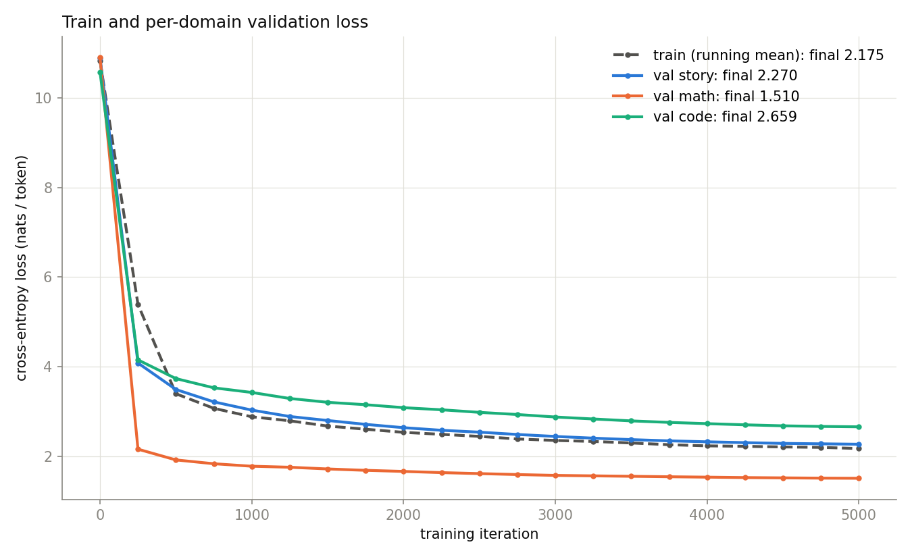
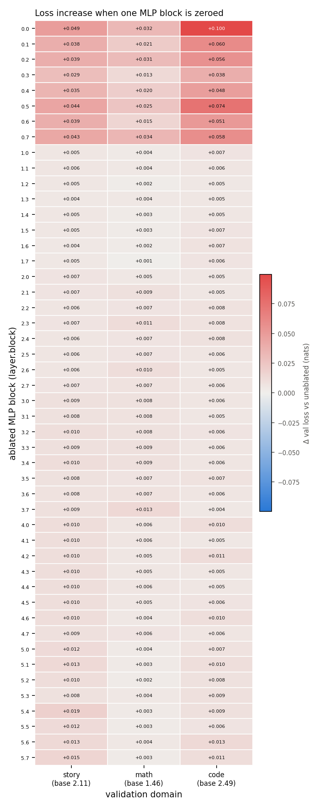
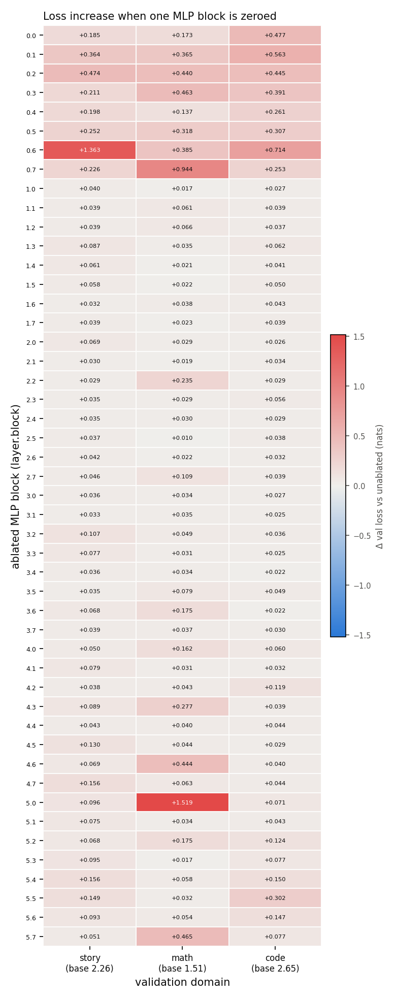

# gradient-routing-slm

Train a small GPT (nanoGPT-style) on a 3-domain corpus (stories, arithmetic, Python code), then ablate MLP blocks one at a time to see which domain each block serves.

The MLP hidden layer in every transformer layer is split into `n_blocks` (8) equal blocks. `--routing_mode` picks how the MLP neurons learn: `assembly` (v2, the current method, which replaces the fixed blocks with self-organizing groups), or the baselines `dense`, `batch` (v0), `token` (v1) and `label` (oracle). If you are coming back to the project, start with [`docs/STATUS.md`](docs/STATUS.md).

## Module status

| Module | Status |
|---|---|
| Data pipeline (`data/prepare.py`) | Completed. Real data (41M tokens) built and used on a T4. |
| Baseline training (`train.py`, `configs/baseline.py`) | Completed. 5000 iterations on a T4, results below. |
| Routing v0, batch mode (`model/routing.py`) | Completed. Implemented, unit-tested, and trained once at full scale on a T4 (single seed). |
| Routing v1, token and label modes (`model/routing.py`) | Baselines. One full token run failed its health check (`docs/findings.md`, section 6). |
| Routing v2, assembly mode (`model/assemblies.py`) | Ongoing: implemented and unit-tested on CPU. No full-scale run yet. |
| Evaluation harness (`eval/`) | Ongoing: loss curves, samples, block and assembly ablation, random baselines and token probes are done. Unlearning and continual learning are pending. |

## Results so far

`results/token_s0/` and the v2 assembly runs are not covered here yet. These are the v0 runs: dense baseline and one batch-routed run (top-2 of 8 blocks per layer, lambda 0.01, hard masking), same seed, same data, same config otherwise.  Kaggle T4, fp16, 5000 iterations, 10.6M non-embedding parameters (29.9M with the tied embedding). Raw files are in [`results/dense_v0/`](results/dense_v0/) and [`results/v0_batch_routing/`](results/v0_batch_routing/). **Each number comes from one seed**, so differences between the two runs have no error bars yet.

### Validation loss and cost of routing

Last eval at iteration 5000 (nats/token):

| Domain | Dense | Routed | Routing cost |
|---|---|---|---|
| story (TinyStories) | 2.120 | 2.270 | +0.150 (+7.1%) |
| math (synthetic) | 1.467 | 1.510 | +0.043 (+3.0%) |
| code (codeparrot) | 2.497 | 2.659 | +0.162 (+6.5%) |
| final train loss (mean of last 250 iters) | 2.042 | 2.175 | +0.133 |

Math loss is not a measure of arithmetic skill: the operand digits are random and cannot be predicted, so the loss has a high floor.

| Dense | Routed |
|---|---|
|  |  |

### Specialization (ablating one MLP block at a time, all 48 blocks)

| | Dense | Routed |
|---|---|---|
| **Mean S** | **0.051** | **0.110** |
| Damage-weighted S | 0.059 | 0.160 |
| Median S | 0.038 | 0.067 |
| Highest single-block S | 0.19 (block 5.4) | 0.64 (block 5.0) |
| Blocks with S above 0.2 | 0 | 8 |
| Mean damage per ablated block (all domains summed, nats) | 0.038 | 0.405 |
| Domain with most damage, count of blocks (story / math / code) | 23 / 6 / 19 | 20 / 16 / 12 |

| Dense | Routed |
|---|---|
|  |  |

Note the colour scales differ: the dense heatmap tops out at 0.1 nats, the routed one at 1.5.

### Block selection during routed training

Frequencies come from `results/v0_batch_routing/routing_stats.csv`. Uniform would be 0.25 (k/n).

- **No dead blocks.** Every block was selected at least 14.7% of the time over the whole run, and none was selected in fewer than 5% of the iterations in the last 1000.
- **Mostly balanced.** Over the whole run, 47 of the 48 blocks were selected 15%-31% of the time. The exception is layer 0, block 6, selected 70% of the time overall (39% in the last 1000 iterations).
- **Early imbalance eased.** The most-selected block's cumulative share fell from 0.84 (iteration 250) to 0.70 (iteration 5000).
- **Cost in time:** training took 20 min 51 s against 19 min 25 s for dense (+7%); the whole pipeline took 25 min 29 s against 24 min 15 s.

### Samples

Checkpoints at iteration 5000, temperature 0.8; full sets in `results/dense_v0/samples.txt` and `results/v0_batch_routing/samples.txt`.

- **Story**, prompt `Once upon a time`. Dense: *"...there lived a tidy little girl. One day she went to the park with her mom. Her mom said, "Let's go for a walk!"..."* Routed: *"...there lived a tidy little girl named Lucy. Lucy loved to play outside in the sunshine. One morning she went to a tree to pick a big tree..."* Both are readable at this scale. The routed stories were more repetitive (one sample repeats "The boat...").
- **Math**, prompt `Q: 37 + 48 = A:`. Both models learned the format and get small sums and products right (`26 - 5 = 21`, `9 x 7 = 63`), and both get the prompt itself wrong (the answer is 85; dense gave 80-88, routed gave 88, 95 and 128) and the large products wrong (521 x 6 = 3126, but the model wrote 3776).
- **Code**, prompt `def add(a, b):`. Dense produced one code-like fragment (`o = b.read(), o.rstrip() ...`, not valid) and two runs of whitespace. All three routed samples were whitespace. Neither model writes useful code at this scale.

### Interpretation

Routing raised specialization in the direction we hoped for: mean S doubled (0.051 to 0.110), and 8 blocks now have S above 0.2 where the dense model has none. The effect is modest and uneven, though. The median block only moved from 0.04 to 0.07, the most specialised blocks are specialised toward math (all of the five highest-S blocks hurt math most), and most blocks still damage all three domains. The routed model also pays for this: validation loss is 3-7% higher, and ablating a block now costs about ten times more loss than in the dense model (0.41 against 0.04 nats on average), so routing seems to have concentrated function into fewer blocks, not just separated it by domain. This is one seed on one dataset mix, so we cannot yet say how much of the S difference is run-to-run variation. It is not evidence that routing yields clean, label-free domain modules, and the multi-seed runs and the label-routing upper bound are what would show that.

## Quick start

```bash
pip install -r requirements.txt
python -m pytest tests/                        # about 15-20 min on CPU (includes full smoke pipelines)
SMOKE=1 ROUTING_MODE=assembly bash run_all.sh  # about 2 min on CPU: synthetic data, 2 layers, 64 dim, 100 iters
ROUTING_MODE=assembly SEED=0 bash run_all.sh   # full run on real data -> out_assembly_s0/ (needs internet; use a GPU)
ROUTING_MODE=dense POSTHOC=1 bash run_all.sh   # dense run plus the post-hoc assembly control
python eval/ablate_assemblies.py --out_dir results/dense_v0 --source posthoc   # post hoc on any existing checkpoint
python eval/compare.py                         # results/comparison.csv and comparison.png from results/<run>/
```

`run_all.sh` runs `prepare -> train -> sample -> plots -> ablate -> routing or assembly evaluation` and stops at the first error. Environment variables:

| Variable | Meaning |
|---|---|
| `ROUTING_MODE` | `dense` (default), `batch`, `token`, `label`, `assembly` |
| `RESOLUTION`, `FLOOR`, `PLASTICITY` | Assembly settings, defaults `1.0`, `0.1`, `rank`. Other values get their own folder, e.g. `out_assembly_r0.5_s0` |
| `LR_SCALE` | Scales the learning rate, for a dense run matched to an assembly run's mean plasticity |
| `POSTHOC=1` | Also cluster the finished model post hoc and ablate it (the dense control) |
| `SEED` | Default 0. Controls model init and batch order. The dataset and validation sets stay fixed across seeds so runs are comparable |
| `MAX_ITERS` | Overrides the config's `max_iters` |
| `OUT_DIR`, `DATA_DIR` | Default `out_<mode>_s<seed>` and `data/out` |
| `SMOKE=1` | Tiny synthetic run |
| `DEVICE`, `PYTHON`, `TRAIN_ARGS`, `PREP_ARGS` | Device override, interpreter, and extra flags |

## Kaggle (T4)

1. Import `kaggle_run.ipynb` into Kaggle. It clones this repo's default branch.
2. Settings: **Accelerator: GPU T4**, **Internet: On**.
3. Set the first cell (`ROUTING_MODE`, `SEED`, `MAX_ITERS`, `RESOLUTION`, `FLOOR`, `POSTHOC`, and so on), then **Run All**. To evaluate an existing checkpoint without training, upload it as a Kaggle dataset and set `POSTHOC_CKPT`.
4. Download the zip from `/kaggle/working/` and unzip it into `results/<zip name>/`. The notebook installs `igraph` and `leidenalg`.

The notebook prints `DATA MODE: real` near the end. Any other value means the HuggingFace download failed and the run used the synthetic fallback. Runs take about an hour (see Runtime below), far below Kaggle's 12-hour limit.

## Files

| Path | What it does |
|---|---|
| `data/prepare.py` | Builds the GPT-2-tokenized corpus in `data/out/`: `train.bin` (documents from all domains shuffled together), `train_domain.bin` (domain id per token: 0 story, 1 math, 2 code), `val_{story,math,code}.bin` (about 0.5M tokens each), and `meta.json`. If data matching the same arguments already exists, it skips the rebuild. |
| `model/model.py` | The GPT. `set_ablation(layer, block)`, `set_block_mask(layer, mask)`, `clear_ablation()`, `record_block_norms(on)`, `get_block_norms()` |
| `train.py` | Training loop with fp16 AMP and GradScaler on CUDA, fp32 on CPU, warmup plus cosine LR, eval on each domain, ETA printout, tokens/sec in `metrics.csv`, `--resume` |
| `model/routing.py` | `GradientRouter` (batch mode, v0) and `TokenRouter` (token and label modes, v1). See Method |
| `model/assemblies.py` | Assembly mode (v2): co-activation tracking, clustering, plasticity, health checks |
| `configs/baseline.py`, `configs/routed.py`, `configs/smoke.py` | Configs. Precedence: defaults < config file < CLI flags. `routed.py` = baseline + batch mode. `run_all.sh` uses `baseline.py` plus `--routing_mode` |
| `eval/sample.py` | `out/samples.txt`: 3 samples for each of 3 prompts |
| `eval/plots.py` | `out/loss_curves.png` |
| `eval/routing_plot.py` | `routing_by_domain.png`: per layer, the fraction of each domain's tokens selecting each block |
| `eval/ablate_assemblies.py` | Ablates each assembly, from a run's final partition or post hoc on any checkpoint: S, size- and damage-weighted S, size-matched random baseline, bootstrap CIs |
| `eval/assembly_probe.py` | `assembly_probe.csv` (top tokens, correlation with position and token frequency) and `assembly_domain_profile.csv` |
| `eval/assembly_health_plot.py` | `assembly_health.png`: number of assemblies and ARI over training |
| `eval/compare.py` | `results/comparison.csv` and `comparison.png`: final loss, mean S and speed per run, mean and std across seeds |
| `eval/ablate.py` | `out/ablation.csv`, `ablation_heatmap.png`, `ablation_summary.txt`, `block_norms.csv`. Before the sweep it asserts that the mask actually changes the logits. |

### Data
- **Stories:** `roneneldan/TinyStories`, streamed (`--story_tokens`, default 20M).
- **Math:** synthetic lines such as `Q: 347 x 58 = A: 20126`. Operators are + - x, with 1–3 digit operands, grouped 20 lines per document (`--math_tokens`, default 10M).
- **Code:** `codeparrot/codeparrot-clean-valid`, field `content`, streamed. Files are capped at 4096 tokens (`--code_tokens`, default 10M).
- `--synthetic` generates tiny template-based fake data for all 3 domains. The script also falls back to this automatically, with a loud warning, if the HuggingFace download fails.

### Ablation metric
For each block, damage on domain d is `loss_ablated[d] - loss_unablated[d]`. All conditions are scored on the same fixed validation windows. The specialization score is `S = 1 - H(p)/log 3`, where `p = max(damage,0) / sum(max(damage,0))`. S is 0 when damage is spread evenly across domains and 1 when it falls on a single domain. Blocks that do no damage anywhere have no defined S and are left out of the reported mean.

## Method: activation-based gradient routing

There are five modes. `assembly` (v2) is the current method. `dense` is the baseline, `batch` is the original method (v0), `token` is v1 and `label` is an oracle baseline. All modes use the same forward computation, so routing only changes how weights learn. Why each version replaced the last, and the open reviewer concerns, are in [`docs/findings.md`](docs/findings.md).

### Assembly mode (v2)

This is Hebbian co-activation clustering. Cannistraci-Hebb Training is related inspiration, not the method. Training is plain dense until `--cluster_start` (500). Per layer:

1. **Co-activation.** An EMA (decay 0.99, no gradient) of the correlation matrix of the $d$ hidden activations, from about 512 sampled tokens per step.
2. **Assemblies.** At step 500 and every `--cluster_every` (500) steps after: keep each neuron's top `--knn` (32) positive correlations, symmetrize, and run Leiden (`--resolution` 1.0; Louvain if Leiden is unavailable). Groups below `--min_size` (16) merge into their most correlated neighbour, and Hungarian matching keeps IDs stable. Neurons with variance below $10^{-8}$ are left out and put in a leftover group with plasticity 1.
3. **Relative activity.** $r(t,g)$ is the mean $|h|$ over assembly $g$ at token $t$, divided by the mean over its current members of each neuron's recent activity.
4. **Plasticity.** With $G$ assemblies and floor $f$ (`--floor`, 0.1), the default `--plasticity rank` gives
   $$p(t,g) = f + (1-f)\left(1 - \frac{\mathrm{rank}_t(g)}{G-1}\right),$$
   so at each token the most active assembly gets 1 and the least active gets $f$. `--plasticity sigmoid` gives $p = f + (1-f)\,\sigma(\alpha(r-1))$ with $\alpha = 4$. No neuron ever has zero plasticity.
5. **Gradient scaling on both projections,** with $P$ the per-neuron multiplier and the forward output unchanged:
   $$y = (h \odot P)\,W_\text{down}^\top + \mathrm{stopgrad}(h \odot (1-P))\,\mathrm{stopgrad}(W_\text{down})^\top + b.$$
   In the last layer, a token's gradient on $W_\text{up}$ rows and $W_\text{down}$ columns is exactly $P$ times the dense gradient, which a test checks. Earlier layers also receive gradient through the tokens a later token attends to.
6. **Health checks.** A layer with fewer than 4 assemblies, or one holding more than half its neurons, is flagged degenerate and trains dense until a later clustering recovers. `assemblies.csv` records this after every clustering, with ARI, splits, merges, dead neurons and sizes.

`--consolidate` (off by default) lowers an assembly's ceiling to $1/(1+\beta\cdot\text{age})$ once its membership has stayed above 0.8 overlap. Adam probably cancels most of this effect, so it is not ready to use (`docs/findings.md`, section 8).

**Evaluation.** `eval/ablate_assemblies.py` zeroes each assembly's neurons and computes S per assembly, mean S, size-weighted and damage-weighted S, bootstrap CIs, and a baseline of 5 random neuron sets of the same size per assembly. On a checkpoint with no assemblies, such as dense, it runs the same clustering post hoc on held-out data. That post-hoc dense number is the key control, because dense models already contain somewhat specialised co-activation groups. Clustering uses the first half of each val set and scoring uses the second half, so these S values are comparable with each other but not with the 8-block S from `eval/ablate.py`.

### Token mode (v1)

For every token $t$ in every layer:

1. **Relative score.** $s(t,b) = \lVert h_b(t)\rVert_2 \,/\, \mathrm{EMA}_b$, where $\mathrm{EMA}_b$ is a running mean (decay 0.99, no gradient) of block $b$'s average energy. Scores measure how active a block is compared with its usual level, so a block cannot win just by being large.
2. **Bias balancing** (as in DeepSeek-V3, with no auxiliary loss). Selection uses $s(t,b) + \mathrm{bias}_b$. After each step, $\mathrm{bias}_b$ goes down by $\gamma = 0.001$ if the block's fraction of selected tokens exceeded $k/n$, and up by $\gamma$ otherwise. The bias only affects selection.
3. **Selection.** Each token keeps its top $k=2$ blocks, giving a per-token mask $m$.
4. **Gradient masking on both projections.** The forward output must stay equal to the dense model, and neither projection may learn from unselected blocks:
   $$h = \mathrm{gelu}(x W_\text{up}^\top),\quad h_\text{sel} = h \odot m,\quad h_\text{rest} = \mathrm{stopgrad}(h \odot (1-m)),$$
   $$y = h_\text{sel} W_\text{down}^\top + h_\text{rest}\, \mathrm{stopgrad}(W_\text{down})^\top.$$
   Masking $h$ alone would be wrong, since $W_\text{down}$ would still receive gradient from every block's activations (a test demonstrates this). This also stops gradient reaching earlier layers through unselected blocks, which v0 did not do.
5. **Optimizer.** A block's $W_\text{up}$ rows or $W_\text{down}$ columns with exactly zero gradient on a step are left bit-identical: no update, no weight decay, and their Adam moments stay frozen.

**What "per token" does and does not guarantee.** Attention lets a token's loss flow back through the earlier tokens it attends to. So a token's loss reaches exactly its own blocks in the last layer, but in earlier layers it reaches the union of the blocks selected by itself and the tokens before it. The tests check both statements.

### Label mode (oracle baseline, Gradient Routing 2024 style)

Same masking, with fixed masks taken from each token's domain label: story uses blocks 0-1, math 2-3, code 4-5, and blocks 6-7 are shared. Because of the attention effect above, a mixed window would let a math token's loss reach story blocks, so label mode trains on **domain-pure windows** (`common.PureWindowSampler`), with windows drawn per domain in proportion to its share of training tokens. This is the only mode that samples differently. Token mode uses labels for logging only, and a test confirms that scrambling them leaves its weights unchanged.

### Batch mode (v0)

Every training step decides, separately for each layer, which MLP blocks get to learn from the whole micro-batch. `--routing` still means this mode.

Let $h_{l,b}(t) \in \mathbb{R}^{d/n}$ be the post-GELU hidden activation of block $b$ in layer $l$ at token $t$, where $n=8$ blocks and $d = 4\,n_\text{embd}$.

1. **Energy.** $a_{l,b} = \frac{1}{|T|}\sum_{t \in T} \lVert h_{l,b}(t)\rVert_2$, averaged over all tokens in the micro-batch.
2. **Selection.** $S_l = \operatorname{top\text{-}k}_b\, a_{l,b}$, with $k=2$ by default (`--route_k`).
3. **Gradient mask.** Block $b$ owns rows $[b\,d/n, (b+1)\,d/n)$ of `c_fc.weight` (the up-projection) and the same columns of `c_proj.weight` (the down-projection). Their task-loss gradient is multiplied by $m_{l,b} = 1$ if $b \in S_l$, else $\epsilon$. The default $\epsilon=0$ (`--route_eps`) is hard routing. The mask is applied with tensor hooks on the weights, so each micro-batch is routed separately. The forward pass is unchanged, and attention, embeddings and LayerNorms train densely.
4. **Load balancing.** Each block keeps an EMA of its selection frequency, $f_{l,b} \leftarrow \beta f_{l,b} + (1-\beta)\,\mathbb{1}[b \in S_l]$, with $\beta = 0.99$ and initial value $k/n$. Its activation share is $p_{l,b} = a_{l,b} / \sum_{b'} a_{l,b'}$. The training objective becomes
   $$\mathcal{L} = \mathcal{L}_\text{LM} + \lambda \sum_{l,b} f_{l,b}\, p_{l,b}, \qquad \lambda = 0.01.$$
   $f$ is treated as a constant. The aux gradient lowers the energy share of blocks that are selected often and raises it for blocks that are selected rarely. At uniform balance the aux term equals $\lambda\, n_\text{layer}\, k/n$.

**Why the aux gradient bypasses the mask in batch mode (`route_mask_aux=False`, the default).** In the default mode, $a_{l,b}$ for the aux term is recomputed on a side graph from `x.detach()`, so its gradient reaches only that layer's `c_fc` rows, and it is not masked. This is the same role the balancing loss plays for an MoE router.

If the aux gradient is masked as well (`--route_mask_aux`), training collapses. A block that loses selection gets no gradient that could make it win again, so routing locks onto a fixed $k$ blocks per layer (the likely role of AdamW weight decay in shrinking idle blocks was not isolated). In the 100-iteration smoke run at $\lambda=0.01$, 9 of 16 blocks were never selected. Over 300 iterations, 12 of 16 were idle in the last 50 iterations (exactly $k$ alive per layer). Even $\lambda=1$ left 6 of 16 idle. Details in [`docs/findings.md`](docs/findings.md). `tests/test_routing.py::test_literal_masking_lets_blocks_die` records this behaviour.

In the default mode, idle blocks keep receiving balancing gradient and do come back into selection. In the CPU smoke test one block per layer tended to win a slot on most steps. At full scale on the T4 selection was much more balanced (see "Block selection during routed training" under Results so far).

**Caveat (batch mode only).** A block whose gradient is zeroed still moves slightly under AdamW: its momentum carries on for a few steps, and weight decay keeps applying. Routing controls what each block learns *from*, not whether its weights stay frozen.

`routing_stats.csv` logs, at every eval and for each (layer, block), `frac_story`, `frac_math` and `frac_code`: the fraction of that domain's tokens that selected the block since the previous eval. Batch mode also logs `freq_ema`, `selected_count`, `selected_frac` and `energy`; token and label modes log `frac_all`, `cum_frac_all`, `bias` and `ema`. Old v0 result files do not have the `frac_*` columns.

The v0 tests (`tests/test_routing.py`) check the following; the v1 tests are in `tests/test_routing_v1.py`:
- (a) Only the top-$k$ blocks per layer receive MLP gradient. This holds for the total gradient with `mask_aux`, and for the task gradient in the default mode. In the default mode, non-selected blocks receive exactly the aux gradient and nothing else.
- (b) With routing off, gradients are dense, and `router.remove()` restores dense gradients bit-for-bit.
- (c) After 100 smoke iterations, no block is dead: every block has been selected, and every currently unselected block still receives gradient.

## Runtime on a T4

Measured on the dense baseline run (Kaggle T4, `results/dense_v0/run.log`):

| Stage | Time |
|---|---|
| prepare (41M tokens streamed + tokenized) | 53 s |
| train (5000 iters × 8192 tokens, fp16) | 19 min 25 s (about 185 ms/iter, plus eval every 250 iters) |
| sample + plots | 8 s |
| ablate (48 blocks × 3 domains × 20 batches) | 3 min 33 s |
| **total** | **24 min 15 s** |

The total is inside the 20-30 minute range I had estimated, but training took longer than my earlier 10-15 minute estimate. `train.py` prints a measured ETA every 50 iterations, which includes eval and checkpoint overhead.

Other modes, measured on the T4: batch training 20 min 51 s, whole pipeline 25 min 29 s; token training 21 min 6 s, whole pipeline 25 min 56 s.

Assembly mode has not run on a GPU, so these are estimates. Training should take about 21-23 min, like token mode. The block ablation takes about 4 min. Assembly ablation takes about 4.5 s per ablated set: with 46 assemblies (what clustering gave on `dense_v0` at resolution 1.0) and 5 random sets each, that is about 21 min, plus 1-2 min for post-hoc clustering and the probes. So an assembly run or a dense run with `POSTHOC=1` takes about 50 min. Higher resolution means more assemblies, so `RESOLUTION=2.0` may take 60-90 min.
