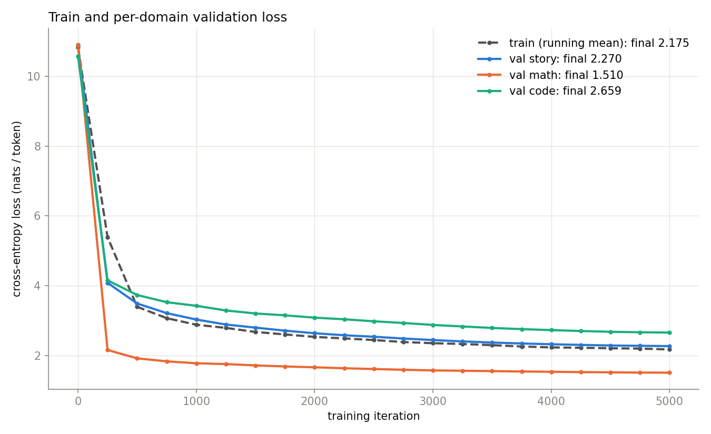
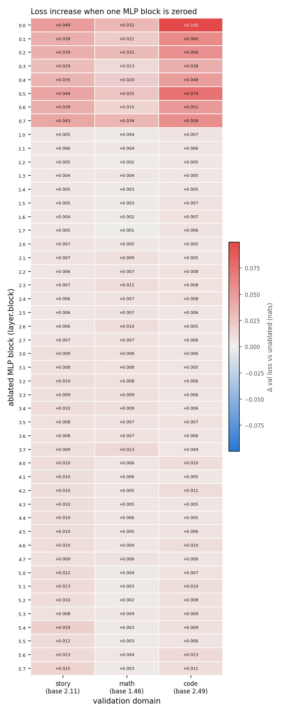
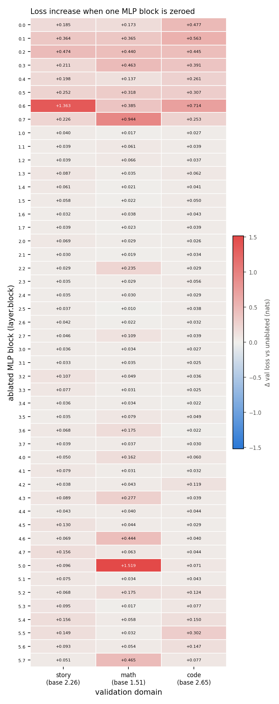

# gradient-routing-slm

Train a small GPT (nanoGPT-style) on a 3-domain corpus (stories, arithmetic, Python code), then ablate MLP blocks one at a time to see which domain each block serves.

The MLP hidden layer in every transformer layer is split into `n_blocks` (8) equal blocks. The baseline trains as an ordinary dense model. The block hooks (ablation mask and per-block activation norms) only switch on at inference, and are there for later gradient-routing experiments.

## Module status

| Module | Status |
|---|---|
| Data pipeline (`data/prepare.py`) | Completed. Real data (41M tokens) built and used on a T4. |
| Baseline training (`train.py`, `configs/baseline.py`) | Completed. 5000 iterations on a T4, results below. |
| Routing module (`model/routing.py`) | Completed. Implemented, unit-tested, and trained once at full scale on a T4 (single seed). |
| Evaluation harness (`eval/`) | Ongoing: loss curves, samples and the ablation matrix are done; domain probes are pending. |

## Results so far

Dense baseline and one gradient-routed run (top-2 of 8 blocks per layer, lambda 0.01, hard masking), same seed, same data, same config otherwise. Kaggle T4, fp16, 5000 iterations, 10.6M non-embedding parameters (29.9M with the tied embedding). Raw files are in [`results/baseline/`](results/baseline/) and [`results/routed/`](results/routed/). **Each number comes from one seed**, so differences between the two runs have no error bars yet.

### Validation loss and cost of routing

Last eval at iteration 5000 (nats/token):

| Domain | Dense | Routed | Routing cost |
|---|---|---|---|
| story (TinyStories) | 2.120 | 2.270 | +0.150 (+7.1%) |
| math (synthetic) | 1.467 | 1.510 | +0.043 (+3.0%) |
| code (codeparrot) | 2.497 | 2.659 | +0.162 (+6.5%) |
| final train loss (mean of last 250 iters) | 2.042 | 2.175 | +0.133 |

Math loss is not a measure of arithmetic skill: the operand digits are random and cannot be predicted, so the loss has a high floor.

| Dense | Routed |
|---|---|
|  |  |

### Specialization (ablating one MLP block at a time, all 48 blocks)

| | Dense | Routed |
|---|---|---|
| **Mean S** | **0.051** | **0.110** |
| Damage-weighted S | 0.059 | 0.160 |
| Median S | 0.038 | 0.067 |
| Highest single-block S | 0.19 (block 5.4) | 0.64 (block 5.0) |
| Blocks with S above 0.2 | 0 | 8 |
| Mean damage per ablated block (all domains summed, nats) | 0.038 | 0.405 |
| Domain with most damage, count of blocks (story / math / code) | 23 / 6 / 19 | 20 / 16 / 12 |

| Dense | Routed |
|---|---|
|  |  |

Note the colour scales differ: the dense heatmap tops out at 0.1 nats, the routed one at 1.5.

### Block selection during routed training

Frequencies come from `results/routed/routing_stats.csv`. Uniform would be 0.25 (k/n).

- **No dead blocks.** Every block was selected at least 14.7% of the time over the whole run, and none was selected in fewer than 5% of the iterations in the last 1000.
- **Mostly balanced.** Over the whole run, 47 of the 48 blocks were selected 15%-31% of the time. The exception is layer 0, block 6, selected 70% of the time overall (39% in the last 1000 iterations).
- **Early imbalance eased.** The most-selected block's cumulative share fell from 0.84 (iteration 250) to 0.70 (iteration 5000).
- **Cost in time:** training took 20 min 51 s against 19 min 25 s for dense (+7%); the whole pipeline took 25 min 29 s against 24 min 15 s.

### Samples

Checkpoints at iteration 5000, temperature 0.8; full sets in `results/baseline/samples.txt` and `results/routed/samples.txt`.

- **Story**, prompt `Once upon a time`. Dense: *"...there lived a tidy little girl. One day she went to the park with her mom. Her mom said, "Let's go for a walk!"..."* Routed: *"...there lived a tidy little girl named Lucy. Lucy loved to play outside in the sunshine. One morning she went to a tree to pick a big tree..."* Both are readable at this scale. The routed stories were more repetitive (one sample repeats "The boat...").
- **Math**, prompt `Q: 37 + 48 = A:`. Both models learned the format and get small sums and products right (`26 - 5 = 21`, `9 x 7 = 63`), and both get the prompt itself wrong (the answer is 85; dense gave 80-88, routed gave 88, 95 and 128) and the large products wrong (521 x 6 = 3126, but the model wrote 3776).
- **Code**, prompt `def add(a, b):`. Dense produced one code-like fragment (`o = b.read(), o.rstrip() ...`, not valid) and two runs of whitespace. All three routed samples were whitespace. Neither model writes useful code at this scale.

### Interpretation

Routing raised specialization in the direction we hoped for: mean S doubled (0.051 to 0.110), and 8 blocks now have S above 0.2 where the dense model has none. The effect is modest and uneven, though. The median block only moved from 0.04 to 0.07, the most specialised blocks are specialised toward math (all of the five highest-S blocks hurt math most), and most blocks still damage all three domains. The routed model also pays for this: validation loss is 3-7% higher, and ablating a block now costs about ten times more loss than in the dense model (0.41 against 0.04 nats on average), so routing seems to have concentrated function into fewer blocks, not just separated it by domain. This is one seed on one dataset mix, so we cannot yet say how much of the S difference is run-to-run variation. It is not evidence that routing yields clean, label-free domain modules, and the multi-seed runs and the label-routing upper bound are what would show that.

## Quick start

```bash
pip install -r requirements.txt
SMOKE=1 bash run_all.sh   # ~1 min on CPU: synthetic data, 2 layers, 64 dim, 100 iters
bash run_all.sh           # full run: real data + configs/baseline.py (needs internet; use a GPU)
ROUTED=1 bash run_all.sh  # full run with gradient routing (configs/routed.py) -> out_routed/
python -m pytest tests/   # block hooks + routing tests (~1 min on CPU)
```

`run_all.sh` runs `prepare -> train -> sample -> plots -> ablate` and stops at the first error. You can pass options through environment variables: `ROUTED=1`, `DEVICE=cpu|cuda`, `PYTHON=python3`, `TRAIN_ARGS="--max_iters 2000"`, `PREP_ARGS="--force"`.

## Kaggle (T4)

1. Push this repo to GitHub (public, or add your token to the URL).
2. Upload `kaggle_run.ipynb` to Kaggle and set `REPO_URL` in the first cell.
3. Settings: **Accelerator: GPU T4**, **Internet: On**. Click **Run All**.
4. Results are written to `/kaggle/working/out/`, along with `run.log`. Set `ROUTED = True` in the first cell to train the routed model instead (outputs in `/kaggle/working/out_routed/`).

Expected wall time is about 20–30 min (see below). The notebook prints `DATA MODE: real` at the end. Any other value means the HuggingFace download failed and the run used the synthetic fallback.

## Files

| Path | What it does |
|---|---|
| `data/prepare.py` | Builds the GPT-2-tokenized corpus in `data/out/`: `train.bin` (documents from all domains shuffled together), `train_domain.bin` (domain id per token: 0 story, 1 math, 2 code), `val_{story,math,code}.bin` (about 0.5M tokens each), and `meta.json`. If data matching the same arguments already exists, it skips the rebuild. |
| `model/model.py` | The GPT. `set_ablation(layer, block)`, `set_block_mask(layer, mask)`, `clear_ablation()`, `record_block_norms(on)`, `get_block_norms()` |
| `train.py` | Training loop with fp16 AMP and GradScaler on CUDA, fp32 on CPU, warmup plus cosine LR, eval on each domain, ETA printout, `--resume` |
| `model/routing.py` | `GradientRouter`: activation-based gradient routing over MLP blocks (see Method). Only active with `--routing` |
| `configs/baseline.py`, `configs/routed.py`, `configs/smoke.py` | Configs. Precedence: defaults < config file < CLI flags. `routed.py` = baseline + routing |
| `eval/sample.py` | `out/samples.txt`: 3 samples for each of 3 prompts |
| `eval/plots.py` | `out/loss_curves.png` |
| `eval/ablate.py` | `out/ablation.csv`, `ablation_heatmap.png`, `ablation_summary.txt`, `block_norms.csv`. Before the sweep it asserts that the mask actually changes the logits. |

### Data
- **Stories:** `roneneldan/TinyStories`, streamed (`--story_tokens`, default 20M).
- **Math:** synthetic lines such as `Q: 347 x 58 = A: 20126`. Operators are + - x, with 1–3 digit operands, grouped 20 lines per document (`--math_tokens`, default 10M).
- **Code:** `codeparrot/codeparrot-clean-valid`, field `content`, streamed. Files are capped at 4096 tokens (`--code_tokens`, default 10M).
- `--synthetic` generates tiny template-based fake data for all 3 domains. The script also falls back to this automatically, with a loud warning, if the HuggingFace download fails.

### Ablation metric
For each block, damage on domain d is `loss_ablated[d] - loss_unablated[d]`. All conditions are scored on the same fixed validation windows. The specialization score is `S = 1 - H(p)/log 3`, where `p = max(damage,0) / sum(max(damage,0))`. S is 0 when damage is spread evenly across domains and 1 when it falls on a single domain. Blocks that do no damage anywhere have no defined S and are left out of the reported mean.

## Method: activation-based gradient routing

With `--routing`, every training step decides, separately for each layer, which MLP blocks get to learn from the batch.

Let $h_{l,b}(t) \in \mathbb{R}^{d/n}$ be the post-GELU hidden activation of block $b$ in layer $l$ at token $t$, where $n=8$ blocks and $d = 4\,n_\text{embd}$.

1. **Energy.** $a_{l,b} = \frac{1}{|T|}\sum_{t \in T} \lVert h_{l,b}(t)\rVert_2$, averaged over all tokens in the micro-batch.
2. **Selection.** $S_l = \operatorname{top\text{-}k}_b\, a_{l,b}$, with $k=2$ by default (`--route_k`).
3. **Gradient mask.** Block $b$ owns rows $[b\,d/n, (b+1)\,d/n)$ of `c_fc.weight` (the up-projection) and the same columns of `c_proj.weight` (the down-projection). Their task-loss gradient is multiplied by $m_{l,b} = 1$ if $b \in S_l$, else $\epsilon$. The default $\epsilon=0$ (`--route_eps`) is hard routing. The mask is applied with tensor hooks on the weights, so each micro-batch is routed separately. The forward pass is unchanged, and attention, embeddings and LayerNorms train densely.
4. **Load balancing.** Each block keeps an EMA of its selection frequency, $f_{l,b} \leftarrow \beta f_{l,b} + (1-\beta)\,\mathbb{1}[b \in S_l]$, with $\beta = 0.99$ and initial value $k/n$. Its activation share is $p_{l,b} = a_{l,b} / \sum_{b'} a_{l,b'}$. The training objective becomes
   $$\mathcal{L} = \mathcal{L}_\text{LM} + \lambda \sum_{l,b} f_{l,b}\, p_{l,b}, \qquad \lambda = 0.01.$$
   $f$ is treated as a constant. The aux gradient lowers the energy share of blocks that are selected often and raises it for blocks that are selected rarely. At uniform balance the aux term equals $\lambda\, n_\text{layer}\, k/n$.

**Why the aux gradient bypasses the mask (`route_mask_aux=False`, the default).** In the default mode, $a_{l,b}$ for the aux term is recomputed on a side graph from `x.detach()`, so its gradient reaches only that layer's `c_fc` rows, and it is not masked. This is the same role the balancing loss plays for an MoE router.

If the aux gradient is masked as well (`--route_mask_aux`), training collapses. A block that loses selection gets no gradient that could make it win again, so routing locks onto a fixed $k$ blocks per layer (the likely role of AdamW weight decay in shrinking idle blocks was not isolated). In the 100-iteration smoke run at $\lambda=0.01$, 9 of 16 blocks were never selected. Over 300 iterations, 12 of 16 were idle in the last 50 iterations (exactly $k$ alive per layer). Even $\lambda=1$ left 6 of 16 idle. Details in [`docs/findings.md`](docs/findings.md). `tests/test_routing.py::test_literal_masking_lets_blocks_die` records this behaviour.

In the default mode, idle blocks keep receiving balancing gradient and do come back into selection. In the CPU smoke test one block per layer tended to win a slot on most steps. At full scale on the T4 selection was much more balanced (see "Block selection during routed training" under Results so far).

**Caveat.** A block whose gradient is zeroed still moves slightly under AdamW: its momentum carries on for a few steps, and weight decay keeps applying. Routing controls what each block learns *from*, not whether its weights stay frozen.

`out_routed/routing_stats.csv` logs, at every eval, `freq_ema`, the cumulative `selected_count` / `selected_frac`, and the last `energy` for each (layer, block).

Tests (`python -m pytest tests/`) check the following:
- (a) Only the top-$k$ blocks per layer receive MLP gradient. This holds for the total gradient with `mask_aux`, and for the task gradient in the default mode. In the default mode, non-selected blocks receive exactly the aux gradient and nothing else.
- (b) With routing off, gradients are dense, and `router.remove()` restores dense gradients bit-for-bit.
- (c) After 100 smoke iterations, no block is dead: every block has been selected, and every currently unselected block still receives gradient.

## Runtime on a T4

Measured on the dense baseline run (Kaggle T4, `results/baseline/run.log`):

| Stage | Time |
|---|---|
| prepare (41M tokens streamed + tokenized) | 53 s |
| train (5000 iters × 8192 tokens, fp16) | 19 min 25 s (about 185 ms/iter, plus eval every 250 iters) |
| sample + plots | 8 s |
| ablate (48 blocks × 3 domains × 20 batches) | 3 min 33 s |
| **total** | **24 min 15 s** |

The total is inside the 20-30 minute range I had estimated, but training took longer than my earlier 10-15 minute estimate. `train.py` prints a measured ETA every 50 iterations, which includes eval and checkpoint overhead.

A routed run costs a little more per iteration, since it re-runs each layer's `c_fc` on detached inputs and does a second, small backward pass for the aux loss. Measured on the T4: training 20 min 51 s (+7%), whole pipeline 25 min 29 s.
