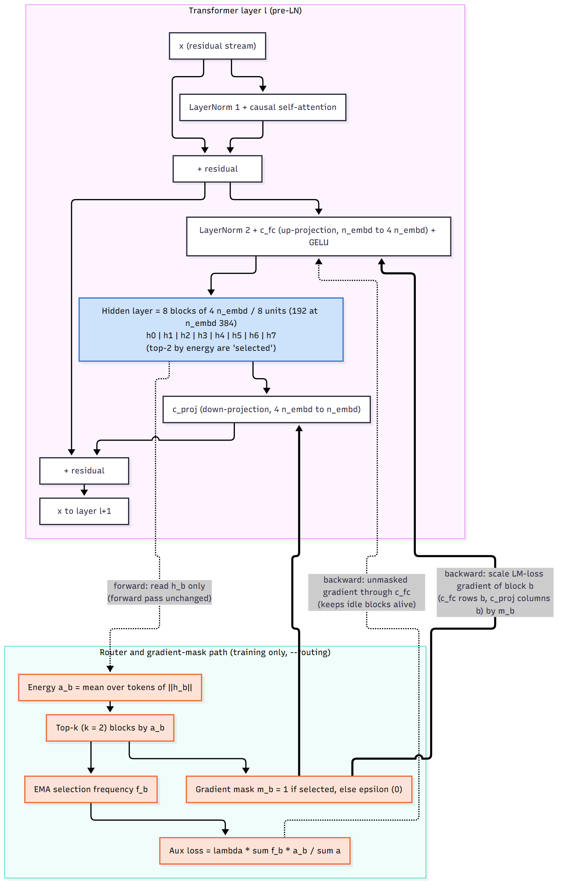
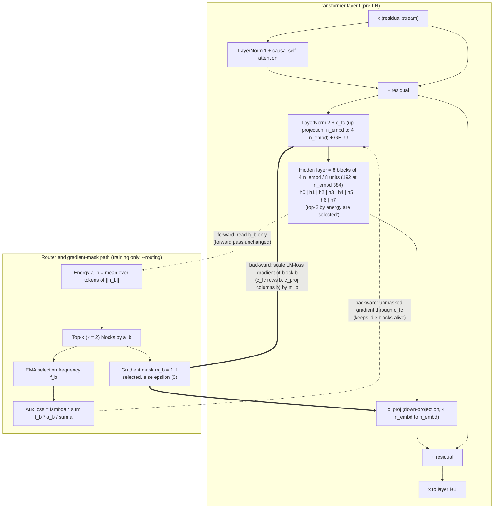
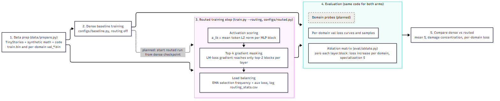
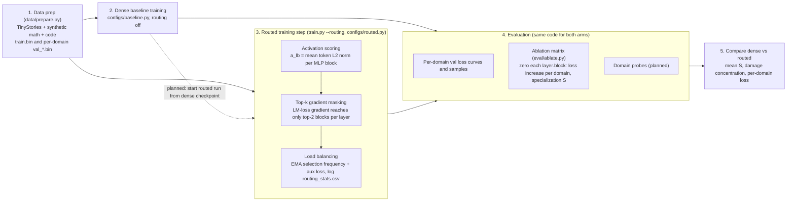

# Architecture

Both diagrams are Mermaid. The sources are `block_diagram.mmd` and `pipeline.mmd`, and the rendered images are `block_diagram.png` and `pipeline.png`.
To re-render: `npx @mermaid-js/mermaid-cli -i docs/block_diagram.mmd -o docs/block_diagram.png -s 2 -b white`.

## (a) Transformer layer with the 8-block MLP and the router / gradient-mask path

Notes:
- The router never changes the forward pass. It only reads each block's activations and changes which blocks receive gradient.
- Implementation: `model/model.py` (`BlockMLP`) and `model/routing.py` (`GradientRouter`).
- The aux-loss gradient bypassing the mask is the default (`route_mask_aux=False`). See the README "Method" section for why.

## (b) Pipeline flow

Notes:
- Activation scoring, masking and load balancing are not separate stages. They run inside every routed training step.
- Today the routed model trains from scratch. Initialising it from the dense checkpoint (the dashed edge) is planned (see `plan.md`).
- The domain probes (dashed box) are planned and do not exist yet.
